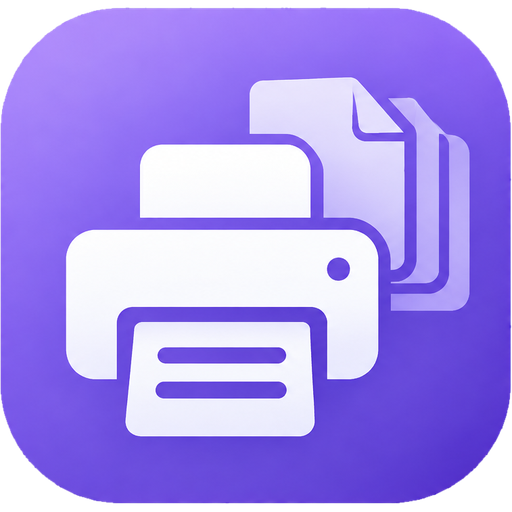

# Sievphov (សៀវភៅ)

Print many PDF files in one go on Windows. Each file has its own printer, **paper tray**, paper, sides, copies and pages,
and **presets** give a saved set of settings to many selected files with one click.
Made for printing books (Khmer books, sastra): two-sided, booklets, page numbers in Khmer digits, watermarks.

Sievphov is laid out like its sister app **Bohpum** (title row with the menus, a toolbar, the files in the middle,
presets and settings on the right) and shares its fonts, boxes and light / dark theme, with the logo's purple.

## Get it

- **Installer:** run `build.bat` on a Windows PC (it needs Node.js, pnpm and the .NET 8 SDK; it says what is missing).
  The installer lands in `dist\Sievphov-Setup-<version>.exe`.
- Or on GitHub: **Actions → Build Windows app → Run workflow** (only runs when started by hand), then download
  **Sievphov-Setup** from the finished run.
- From source while working on it: `run.bat`, or `pnpm install` then `pnpm start`. Both build the print engine
  (`engine-dist\Sievphov.Engine.exe`) when it is missing or older than its code; that needs the .NET 8 SDK
  (`winget install Microsoft.DotNet.SDK.8`). `pnpm run engine` builds it by hand.

Windows may show "Windows protected your PC" for the unsigned installer: **More info → Run anyway**.

## How to use

| To do this | Do this |
|---|---|
| Add files | Drag PDFs or folders onto the window, or **Add files** (Ctrl+O) / **Add folder** (Ctrl+Shift+O: include subfolders, pick a preset) |
| Choose what prints | Tick the files. **▶ Print N files** at the bottom right prints every ticked file (Ctrl+P). |
| Use a preset | Select files (click, Ctrl+click, Shift+click, Ctrl+A) → pick the preset at the top of the panel on the right → **Apply to selected**. Or right-click a file → a preset, or **Ctrl+1 … Ctrl+9**. |
| Change settings | Select one or more files: the panel on the right shows their settings. A change applies at once to every selected file, only for that setting. Values that differ from the file's preset are **bold** with a dot; the Preset column shows `*`; **Reset to preset** puts them back. "Files differ" / **Mixed** means the selected files have different values. |
| Make or edit presets | **Save as preset…** saves the selected file's settings as a new preset; **Update preset** gives the chosen preset the selected file's settings. **Manage presets…**: edit, rename, duplicate, set as default (given to files you add), delete, Up / Down and Import / Export (copy presets to another PC). Ctrl+click or Shift+click several presets to change one setting on all of them (the others stay their own). **Save presets** keeps the box open, for the next preset. |
| Pick a layout | **Layout** (as in Sastra PDF): **One page per sheet** (size on the paper, position), **Multiple pages per sheet** (2, 4, 6, 9 or 16; page order horizontal / vertical, or reversed, starting on the right), **Booklet** (both sides, **front side only** or **back side only** — for a printer that can't print both sides: fronts, put the stack back, backs; binding; Reverse order = last sheet first). The chosen layout's settings are in the box under it. |
| Check before printing | **Preview** (F5) shows every ticked file one after the other, each with its preset, and every sheet as it will print on the file's printer and paper (books: front and back side by side, with the fold / spine marked). Pick another preset above a file to see how it would print; click a sheet to see it large. **Estimate** shows pages and paper per printer. |
| Print many books | **Copies** (per file) prints that file several times — for a booklet from one PDF, that is the number of books. **Repeat** (next to the Print button) prints the **whole list** that many times, set after set — for a book made of several files (cover, chapters …), set it to the number of books. Saved jobs keep it. |
| Broken files | **Print** reads the files again first. If one cannot be read (damaged, moved, deleted, or still locked), nothing prints: a warning names it and selects it. Repair or replace it and press Print again, or remove it from the list. |
| Replace a file | A file was moved, renamed or deleted, or there is a newer version: select it → right-click → **Replace file…** (or Edit › Replace File; double-click a file that says *Can't read*). Pick the PDF; the row keeps its place, preset and settings. A file that cannot be read, or one already in the list, is refused and the row stays as it was. |
| Separate with blank paper | Select a file → **Blank paper** (Ctrl+B, Edit › Insert Blank Paper, or right-click → Insert blank paper after). A **Blank paper** row goes in under it: a sheet with nothing printed on it but a tiny black dot near one corner (printers can skip a page that looks empty), printed in its place in the list. It takes that file's preset and settings and has its own like any file — printer, **paper tray** (e.g. coloured paper), paper, sides; **Copies** = how many blank sheets. Move it, copy it or apply presets to it like a file; saved jobs keep it. |
| Another printer, other trays | When a ticked file's **paper tray** is not on the printer it prints on (e.g. a preset made for another printer), **Print** first opens **Swap trays**: one row per tray, *printer A · Tray 1 → printer B · [its trays]* (a tray remembers the printer it was picked on), with the files under it. The box lists every such file, each time; **Remember for next time** (saved in `settings.json`) picks the same tray already the next time (marked *As last time*). The file gets the new tray (with a `*`). |
| While printing | **Pause** / **Stop** at the bottom right. At the end a report lists what printed and what failed; **Save as CSV (Excel)**. |
| After printing | **File › After Printing…**: do nothing, or move / copy the printed PDFs to a folder. |
| Reuse a list | **Save job** (Ctrl+S) saves the list with every file's own settings as `.svpv`; double-click a `.svpv` to open it. |
| Order | Drag rows, ▲ ▼ (Alt+↑ / Alt+↓), or click a column heading to sort. |

When a preset is edited, files using it **without** a `*` get the new settings; files with a `*` keep their own changes.

Settings per file and in presets: printer, copies (collated or not), all / odd / even / custom pages (`1-5, 8, 12-last`),
reverse order, **paper tray**, paper size, one side / both sides (long or short edge), orientation (auto turns pages to
fit), fit / shrink / actual size / fill / zoom, position, color or grayscale, quality (150 / 300 / 600 dpi), layout
(one page per sheet, 2 / 4 / 6 / 9 / 16 pages per sheet, **booklet** with left / right binding, both sides or front / back only), page numbers (position incl. the outside edge
of a book, `ទំព័រ {page}` / `{page} / {pages}`, Khmer digits, start number, font, size, color), text watermark and logo.

Presets and options are in `%AppData%\Sievphov` (presets.json from version 1 still loads). Saved passwords for locked
PDFs are stored there in plain text.

## For developers

```
main.js        Electron main: window + title bar, ☰ menu, dialogs, presets/settings/jobs files, the engine
engine.js      talks to the print engine over stdin/stdout; has a stand-in engine (SIEVPHOV_FAKE_ENGINE=1, or not Windows)
preload.js     window.sievphov
app/           the screens: index.html, app.css, app.js, model.js (preset and job rules), notes.js (What's new)
engine/        C#: Sievphov.Core (settings, page ranges, booklet / N-up, PDF reading with PDFium) and
               Sievphov.Engine (printing per file with its own printer, tray, paper, sides; preview; --selftest)
tests/         node tests (pnpm test), the window test (pnpm run test:ui, Linux: xvfb-run -a -s "-screen 0 1600x1000x24"), engine-real.test.js (Windows)
docs/superpowers/specs/  design notes
art/           the logo and the .svpv file icon (original artwork and cut-out PNGs)
```

- `pnpm run engine` builds `engine-dist/Sievphov.Engine.exe` (runs the C# tests first); `pnpm run dist` builds the installer.
- `engine-dist\Sievphov.Engine.exe --selftest <folder>` prints sample books to "Microsoft Print to PDF" without paper.
- The GitHub workflow runs only when started by hand.
