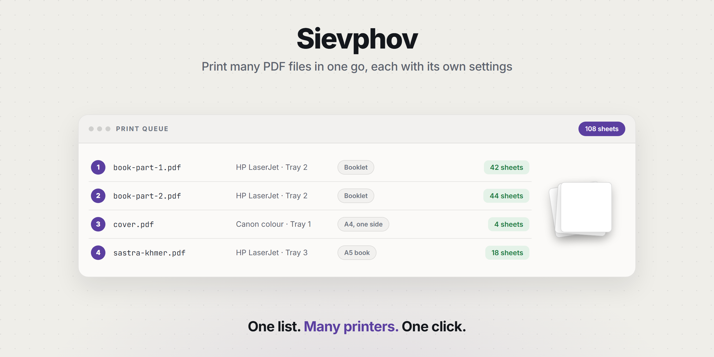
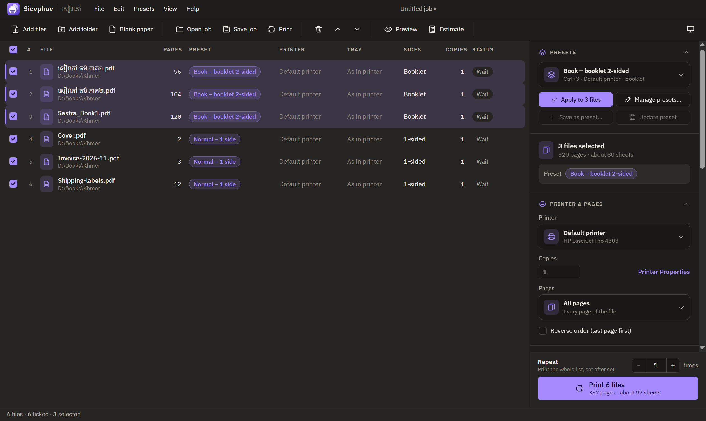

<div align="center">


# Sievphov (សៀវភៅ)

**Print many PDF files in one go — each with its own printer, paper tray and settings.**<br>
Made for printing books, including Khmer books and sastra.

<a href="https://apps.microsoft.com/detail/9n3c696q2sk7">
  
</a>


[](LICENSE)

</div>

<picture>
  <source media="(prefers-color-scheme: dark)" srcset="art/banner-dark.png">
  
</picture>

*Sievphov* (សៀវភៅ) means "book" in Khmer.

## Features

- **One list, many PDFs** — every file keeps its own printer, paper tray, paper size, sides, copies and pages.
- **Presets** — save a set of settings once and give it to many files with one click, or with Ctrl+1 … Ctrl+9.
- **Book printing** — booklets (both sides, or front and back separately for printers without two-sided printing),
  2 to 16 pages per sheet, page numbers in Khmer digits, text and logo watermarks.
- **Preview and estimate** — see every sheet before it prints, and how much paper each printer will use.
- **Print many books** — copies per file, repeat the whole list, and blank separator sheets between sets.
- **Saved jobs** — keep a whole list with its settings as a `.svpv` file and open it again with a double-click.
- **Safe printing** — files are checked again before printing; a report at the end can be saved for Excel.
- **Private** — works offline; your files never leave your computer. Light and dark theme.
- **Always up to date** — the Microsoft Store version downloads and installs new versions for you.

<p align="center">
  
</p>

## Install

**Microsoft Store (recommended)** — [get Sievphov from the Microsoft Store](https://apps.microsoft.com/detail/9n3c696q2sk7).
It is free and updates itself.

**Build it yourself** — on a Windows PC with Node.js, pnpm and the .NET 8 SDK, run `build.bat`
(it tells you if anything is missing). The installer is saved as `dist\Sievphov-Setup-<version>.exe`.
Windows may show "Windows protected your PC" for this unsigned installer: choose **More info → Run anyway**.

## How to use

| To do this | Do this |
|---|---|
| Add files | Drag PDFs or folders onto the window, or **Add files** (Ctrl+O) / **Add folder** (Ctrl+Shift+O). |
| Choose what prints | Tick the files, then **Print** at the bottom right (Ctrl+P). |
| Use a preset | Select files (click, Ctrl+click, Shift+click, Ctrl+A), pick a preset at the top of the right panel, then **Apply to selected**. Or right-click a file, or press **Ctrl+1 … Ctrl+9**. |
| Change settings | Select one or more files; the right panel shows their settings. A change applies to every selected file. Values that differ from the preset are **bold** and the preset name gets a `*`; **Reset** puts them back. |
| Make or edit presets | **Save as preset…**, **Update preset**, or **Manage presets…** to edit, rename, duplicate, reorder, delete, import and export. Select several presets to change one setting on all of them. |
| Pick a layout | **One page per sheet**, **Multiple pages per sheet** (2, 4, 6, 9 or 16) or **Booklet** (both sides, front only or back only, left or right binding). |
| Check before printing | **Preview** (F5) shows every sheet as it will print, with front and back side by side for books. **Estimate** shows pages and paper per printer. |
| Print many books | **Copies** prints one file several times. **Repeat** prints the whole list several times, set after set. |
| Fix a broken or moved file | **Print** checks every file first and stops if one cannot be read. Right-click it → **Replace file…** (or double-click a file that says *Can't read*) and pick the PDF again; the row keeps its place, preset and settings. |
| Separate with blank paper | Select a file and press **Blank paper** (Ctrl+B). The blank sheet can use its own tray, for example coloured paper. |
| Use another printer | If a file's tray is not on its printer, **Swap trays** asks which tray to use and can remember your choice. |
| While and after printing | **Pause** or **Stop** at any time. A report lists what printed; **Save as CSV**. **File › After Printing…** can move or copy the printed files. |
| Reuse a list | **Save job** (Ctrl+S) saves a `.svpv` file; double-click it to open it again. |
| Update | The Store version updates itself. A badge at the top right shows the download (**↓ Update 45%**), then **Update ready**: choose **Install** now or **Later**. **Help › Check for Updates** checks at once. |

<details>
<summary><b>All settings</b></summary>

Printer, copies (collated or not), all / odd / even / custom pages (`1-5, 8, 12-last`), reverse order, paper tray,
paper size, one side / both sides (long or short edge), orientation (auto turns pages to fit), fit / shrink /
actual size / fill / zoom, position, colour or grayscale, quality (150 / 300 / 600 dpi), layout (one page per sheet,
2 / 4 / 6 / 9 / 16 pages per sheet, booklet), page numbers (position including the outside edge of a book,
`ទំព័រ {page}` / `{page} / {pages}`, Khmer digits, start number, font, size, colour), text watermark and logo.

When a preset is edited, files that use it without a `*` get the new settings; files with a `*` keep their own changes.

</details>

## Your data

Sievphov works offline and never sends your files or anything about you. The only network traffic is the Store
version asking the Microsoft Store for updates (at start and every 6 hours). Presets and options are stored in
`%AppData%\Sievphov`. Passwords you choose to remember for locked PDFs are kept there in plain text.

## For developers

Requirements: Windows, Node.js, pnpm and the .NET 8 SDK (`winget install Microsoft.DotNet.SDK.8`).

```bash
pnpm install     # also builds the print engine
pnpm start       # run the app (or run.bat)
pnpm test        # tests
pnpm run dist    # build the installer
```

| Part | What it is |
|---|---|
| `main.js`, `preload.js` | Electron main process: window, menus, dialogs, presets / settings / job files |
| `engine.js` | Talks to the print engine; includes a stand-in engine (`SIEVPHOV_FAKE_ENGINE=1`) that prints nothing |
| `app/` | The user interface |
| `store-update.js`, `store-update/` | Microsoft Store updates (Store package only; helper built by `pnpm run store-helper`) |
| `engine/` | C# print engine: page ranges, booklet and N-up layout, PDF reading with PDFium, printing per file |
| `tests/` | Node tests, a window test (`pnpm run test:ui`) and real-engine tests (Windows) |
| `docs/` | Design notes and images |

`engine-dist\Sievphov.Engine.exe --selftest <folder>` prints sample books to "Microsoft Print to PDF" without paper.
The GitHub build workflow runs only when started by hand (**Actions → Build Windows app → Run workflow**).

## Contributing

Bug reports and ideas are welcome in [Issues](https://github.com/smith89k/Sievphov/issues).
For code changes, open a pull request and run `pnpm test` first.

## License

Sievphov is free and open source under the [MIT License](LICENSE). © 2026 Sunnguon Taing.

The bundled fonts (IBM Plex Sans, IBM Plex Mono, Noto Sans Khmer) are under the SIL Open Font License 1.1,
and PDF reading uses PDFium (BSD-3-Clause / Apache-2.0). See [THIRD-PARTY-NOTICES.md](THIRD-PARTY-NOTICES.md).
